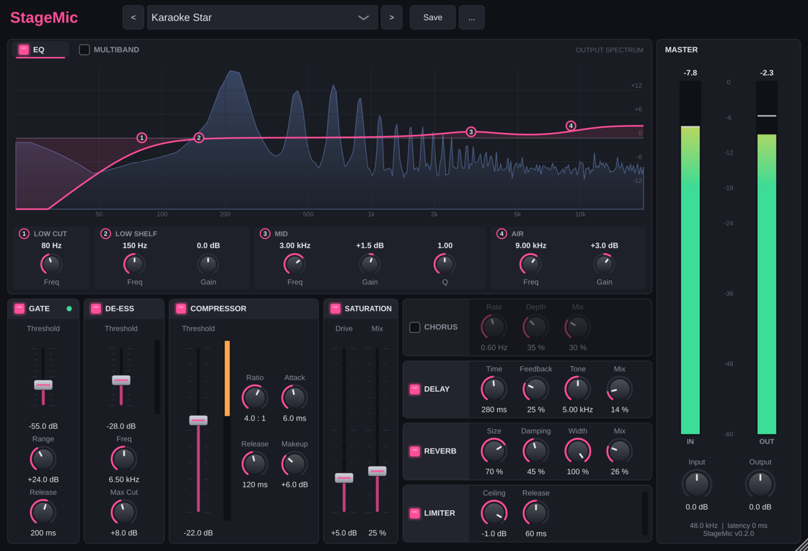

# Paopoa StageMic

A vocal chain for OBS Studio, in one audio filter and one window: noise gate, EQ, de-esser,
compressor, warmth, reverb, echo and real-time pitch correction. Made for singing streams, and
just as useful for talking, gaming and ASMR.



**Download:** [mengsimaong.itch.io/paopoa-stagemic](https://mengsimaong.itch.io/paopoa-stagemic)
(Windows 10/11, OBS Studio 31 or newer). Free, no account needed.
Installing and troubleshooting: [docs/INSTALL.md](docs/INSTALL.md).

## What it does

* **Simple and Advanced modes.** Simple shows the few controls that matter with plain labels;
  Advanced shows every module, a 7-point EQ over a live spectrum, multiband compression and a
  re-orderable signal chain. Switching never changes the sound.
* **Set up my voice.** An 11-second measurement sets input gain, the noise gate (including for
  noisy rooms and laptop fans) and the de-esser frequency for the mic in use.
* **Pitch correction** from natural to the hard robotic effect: key, scale, speed, amount,
  formant and transpose, with a live pitch graph.
* **Presets** for singing, talking, ASMR and fun voices; save, import and export your own
  (`.stagemicpreset` files).
* **Beginner help:** a level read-out in plain words ("Too quiet", "Mic is clipping") and a
  "Hold: hear before" button to compare with the untouched mic.

## Performance and latency

* **Zero latency** through the chain: no effect uses a lookahead buffer. The exceptions are
  explicit: pitch correction adds 20 ms while it is switched on, and the oversampled Warmth and
  Air add about 0.1 ms to their own colour only.
* **Light:** modules that are off cost nothing, and an EQ band that is flat or off is skipped.
  The default sound uses about 1% of one CPU core; every module at once stays well under 10%.
* **Safe on the audio thread:** no memory allocation, no locks, no clicks when switching effects
  or presets.

## How it is tested

Every push builds and tests on Windows and Linux (GitHub Actions), and loads the filter into a
real OBS instance to check that audio flows.

* **Unit tests** (`tests/`, about 80 groups) drive the engine exactly as OBS does. Among them:
  bit-exact pass-through when everything is off, no allocation on the audio thread, no clicks on
  parameter sweeps and on/off switches, the drawn EQ curve within 0.75 dB of the measured
  response, pitch correction landing on the note across the vocal range, and the window driven
  with real mouse events.
* **Stress test** (`stagemic_bench`): CPU per module and preset in OBS-sized blocks, plus abuse
  cases (NaN input, full-scale square waves, knob storms, preset hopping, odd block sizes, long
  silence after loud sound).
* **Before each release:** the tests and the stress test under AddressSanitizer and
  UndefinedBehaviorSanitizer, the live window with audio on its own thread under ThreadSanitizer,
  and an instruction-count comparison (valgrind) against the previous release so nothing gets
  slower.

## Building

You don't need to build it yourself: GitHub Actions produces the Windows installer.

* **Windows:** Visual Studio 2022 with the C++ workload and CMake 3.28 or newer.
  ```
  cmake --preset windows-x64
  cmake --build --preset windows-x64
  ```
  The first configure downloads and builds the OBS libraries (about 10 minutes).
* **Linux (development):** `apt install libobs-dev obs-studio` plus JUCE's usual dependencies
  (see `.github/workflows/build.yml`), then `cmake --preset linux && cmake --build --preset linux`.
* **Engine, tests and tools only (no OBS):** `cmake --preset engine-only`.

How the pieces fit together: [docs/ARCHITECTURE.md](docs/ARCHITECTURE.md). The published methods behind
the audio processing: [docs/ALGORITHMS.md](docs/ALGORITHMS.md).

## Project layout

| Folder | Contents |
|---|---|
| `src/core` | The audio engine: processor, parameters, presets, voice analysis |
| `src/core/dsp` | The modules: gate, EQ, dynamics, effects, pitch correction, safety limiter |
| `src/ui` | The window (JUCE components) |
| `src/obs` | The OBS filter and the JUCE message thread inside OBS |
| `tests` | Unit tests |
| `tools` | `stagemic_render` (render presets to WAV), `stagemic_bench` (stress test), `stagemic_devtools` (screenshots, artwork, live window measurements) |

## License

AGPL-3.0-or-later: free to use, including on monetized streams. If you distribute a modified
version, you must share its source code too. Built with the AGPL edition of JUCE.
See [LICENSE](LICENSE) and [THIRD_PARTY.md](THIRD_PARTY.md).
